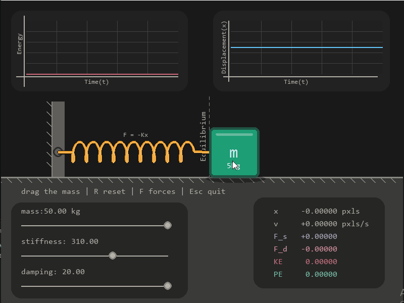

<h1 align="center"> Horizontal Spring-Mass Simulator </h1>

<p align="center">A 2D interactive horizontal spring-mass simulator which oscillates about x-axis back and froth purely made using <b>Python</b> and its libraries like <b>numpy</b> and <b>pygame</b>.</p>

<p align="center">
  
  
  
  
</p>

<p align="center">
  
</p>

---

## 📖 About

This simulation lets user control **mass**, **stiffness coefficent** and **damping coefficent** in real time and lets them observer how each factor affect the oscilation of the spring, helping visual learners and teaching people how spring behaves.

🎥 [Watch the video](https://github.com/sevenbuilds/Terra_Projects/issues/1)

## ✨ Features:
- **Interactive**: you can interact with the system by dragging the mass
- **Adjustable mass**: mass of the system can be controlled in real time using slidebar
- **Adjustable stiffness**: you can observe how stiffness coefficent affect the spring behavior 
- **Adjustable damping**: using slidebar you can experiment with damping of the system
- **Force Visualization**: you can see which force in acting on which direction and with what magnitude
- **Live calculation**: you can observe the values changing live in the right-bottom block
- **Reset**: by pressing "R" you can restore the simulation inital state

## 📐 Physics behind simulation:
A horizontal spring-mass system is simulated using equations like,
- **Hooke's law**: spring_force =  -stiffness coefficient * displacement
- **Damping force(2D)**: damping force = -damping coefficient * velocity
- **Newton 2nd law**: net_force = mass * acceleration
- **Kinetic energy**: 0.5 * mass * velcoity^2
- **Potential energy of spring**: 0.5 * stiffness coeffcient * displacement^2

## 🚀 How to run:
**Option 1**: Download the Executable (**Recommended**)
1. Go to [Releases](https://github.com/sevenbuilds/Terra_Projects/releases/tag/v1.0.0) page.
2. Download SpringMass.exe from the lastest release.
3. Double-click the downloaded file so launch the simulation.
4. If faced with "Windows protection" click more info down below.
5. choose the option "Run anyway".
6. Enjoy the simulation!
---
**Option 2**: Run from source
if you want to run or modify the code:
- you must have **Python 3.13**, **Pygame CE** and **Numpy**.

Install the dependencies:
```bash
pip install pygame-ce numpy
```
Clone the repository:
```bash
git clone https://github.com/sevenbuilds/Terra_Projects.git
```
Navigate to the project directory:
```bash
cd Terra_Projects
```
Run the simulation:
```bash
python Simulation.py
```

## 📄 License

This project is licensed under the MIT License.

## Contact

GitHub: [@sevenbuilds](https://github.com/sevenbuilds)

---

<p align="center">⭐ If you found this useful, consider starring the repo!</p>
